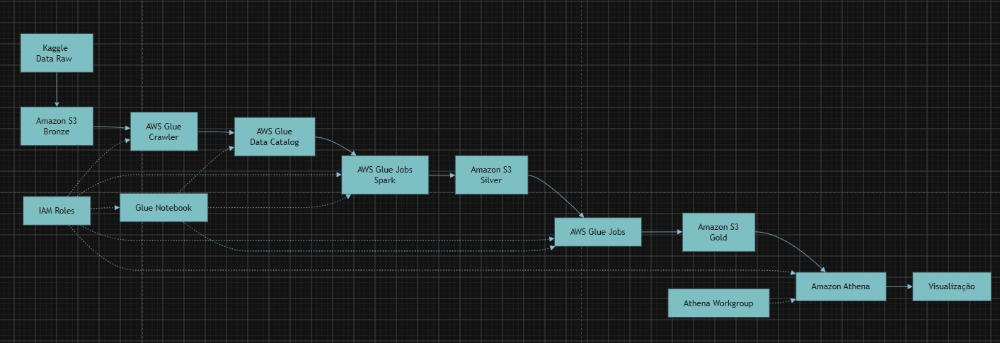

# 📊 Panorama do Mercado Brasileiro de Dados & IA

[](https://www.python.org/downloads/)
[](https://spark.apache.org/)
[](https://aws.amazon.com/glue/)

Solução completa de **Engenharia de Dados e Analytics** que analisa o panorama do mercado brasileiro de Dados e Inteligência Artificial através de dados da pesquisa **State of Data Brasil** (edições 2023/2024, 2024/2025 e 2025/2026).

## 🎯 Objetivo

Desenvolver uma solução de engenharia de dados aplicando conceitos de **Big Data**, **Data Lake** e **Analytics** para compreender:

- 📈 Perfil dos profissionais de tecnologia e dados no Brasil
- 🔍 Tendências de mercado e tecnologias mais demandadas
- 💼 Diferenças de remuneração por senioridade, região e modelo de trabalho
- 👥 Diversidade de gênero nas carreiras de dados
- 🤖 Adoção de Inteligência Artificial no mercado
- 💡 Recomendações estratégicas para empresas

## 🏗️ Arquitetura da Solução

A solução utiliza a **arquitetura Medallion** em camadas, implementada totalmente na **AWS**:

```
┌─────────────────────────────────────────────────────────────┐
│  FONTE EXTERNA (Kaggle - State of Data Brazil)              │
└────────────────────────┬────────────────────────────────────┘
                         │
                         ▼
┌─────────────────────────────────────────────────────────────┐
│  BRONZE LAYER                                               │
│  📁 Dados brutos em CSV (3 edições)                         │
│  s3://bucket/bronze/state_of_data/ano=*/                    │
└────────────────────────┬────────────────────────────────────┘
                         │
                  ETL.py (AWS Glue)
                         │
                         ▼
┌─────────────────────────────────────────────────────────────┐
│  SILVER LAYER                                               │
│  🔧 Normalização de colunas, conversão para Parquet         │
│  s3://bucket/silver/state_of_data/ano=*/                    │
└────────────────────────┬────────────────────────────────────┘
                         │
            job_silver_unificada_v2.py (AWS Glue)
                         │
                         ▼
┌─────────────────────────────────────────────────────────────┐
│  SILVER FINAL (Unified)                                     │
│  🗂️ Base única com esquema canônico                          │
│  s3://bucket/silver_final/state_of_data_unificado/          │
│  ├── AWS Glue Crawler                                       │
│  ├── AWS Glue Data Catalog                                  │
│  └── Amazon Athena (consultas ad-hoc)                       │
└────────────────────────┬────────────────────────────────────┘
                         │
        TechChallenge_Notebook_Unificado_v4.ipynb
                    (PySpark/Jupyter)
                         │
                         ▼
┌─────────────────────────────────────────────────────────────┐
│  GOLD LAYER                                                 │
│  📊 Agregações analíticas e insumos gráficos                │
│  s3://bucket/gold/                                          │
│  ├── Análises executivas                                    │
│  ├── Insumos para DataViz                                   │
│  └── Relatórios temáticos                                   │
└─────────────────────────────────────────────────────────────┘
                         │
                         ▼
                  VISUALIZAÇÃO & BI
              (Power BI, Tableau, etc)
```

### Diagrama da arquitetura (AWS)



## 📂 Estrutura do Projeto

```
TC_FIAP-Fase3/
├── README.md
├── requirements.txt
├── Bronze/
│   └── ETL.py                                   # Ingestão CSV → Parquet (AWS Glue)
├── Silver/
│   ├── job_silver_unificada_v2.py               # ⭐ Unificação das 3 edições (versão final)
│   └── padronizacao_silver.py                   # Unificação v1 (referência)
├── Gold/
│   └── TechChallenge_Notebook_Unificado_v4.ipynb   # Análises PySpark e gráficos
├── docs/
│   └── TECHNICAL_DOCUMENTATION.md               # Documentação técnica detalhada
└── reports/
    └── diagrama_arquitetura.jpeg                # Diagrama da arquitetura AWS
```

## 🚀 Como executar

### Pré-requisitos

- Conta no **AWS Academy Lab** (S3, Glue, Athena)
- Bases do State of Data Brasil: https://www.kaggle.com/datahackers/datasets
- Para a camada Gold local: Python 3.9+ e Java (exigido pelo Spark)

### Passos

1. **Clone o repositório**
```bash
git clone https://github.com/ThiOliveira86/TC_FIAP-Fase3.git
cd TC_FIAP-Fase3
```

2. **Instale as dependências** (camada Gold)
```bash
pip install -r requirements.txt
```

3. **Configure as credenciais temporárias do AWS Academy** (AWS Details → Show)
```bash
aws configure
```

4. **Ajuste o nome do bucket S3.** Nos scripts e no notebook, o bucket aparece como `tc-fase3-state-of-data-seu-id`. O nome original usava a matrícula (RM) de um integrante do grupo e foi substituído por esse marcador **por questão de privacidade**. Como nomes de bucket S3 são únicos globalmente, troque `seu-id` por um identificador seu (por exemplo, seu RM ou nome de usuário) antes de executar.

5. **Rode o pipeline**, seguindo a seção [Execução do Pipeline](#-execução-do-pipeline).

## 📊 Resultados Principais

### Volumetria dos Dados
| Edição | Registros |
|--------|----------:|
| 2023/2024 | 5.293 |
| 2024/2025 | 5.217 |
| 2025/2026 | 3.495 |
| **Total** | **14.005** |

### Insights Principais

#### 🎯 Estrutura do Mercado
- **42,5%** dos profissionais concentrados em 3 cargos: Analista de Dados, Cientista e Engenheiro
- **76%** de participação masculina (afunilamento conforme senioridade)
- **61%** de empresas tratam IA como foco principal ou prioritário

#### 💰 Salários Médios Estimados
| Cargo | Salário Médio |
|-------|:-------------:|
| Arquiteto de Dados | R$ 16.684 |
| Engenheiro de ML | R$ 16.185 |
| Engenheiro de Dados | R$ 12.722 |
| Cientista de Dados | R$ 11.626 |
| Analista de Dados | R$ 7.881 |

#### 🌍 Distribuição Regional
- **Sudeste**: 8.476 profissionais (R$ 7.050)
- **Sul**: 2.532 profissionais (R$ 6.570)
- **Nordeste**: 1.504 profissionais (R$ 6.050)

#### 🛠️ Tecnologias Dominantes
- **Python**: 55,2% (crescimento)
- **SQL**: 50,5% (em declínio)
- **AWS**: Liderança em cloud, mas perdendo market share
- **Databricks**: Crescimento forte em tecnologias lakehouse

## 📋 Componentes do Pipeline

### 1. **ETL.py** - Bronze → Silver
- **Ambiente**: AWS Glue Visual ETL
- **Função**: Ingestão de CSV e conversão para Parquet
- **Entrada**: 3 arquivos CSV (uma por edição)
- **Saída**: Parquet normalizado com nomes de coluna padronizados
- **Status**: ✅ Produção

### 2. **job_silver_unificada_v2.py** - Silver Consolidation
- **Ambiente**: AWS Glue Job (Script Editor)
- **Função**: Unificação das 3 edições, mapeamento de categorias
- **Entrada**: Parquet individual por edição (Silver)
- **Saída**: Base única com 64 atributos
- **Validação**: Dupla verificação independente (14.005 registros)
- **Status**: ✅ Produção (v2)

### 3. **TechChallenge_Notebook_Unificado_v4.ipynb** - Gold Analytics
- **Ambiente**: Jupyter + PySpark
- **Função**: Análises exploratórias, agregações, geração de insumos gráficos
- **Entrada**: Base unificada (Silver Final)
- **Saída**: 7 respostas a questões de negócio + gráficos + CSV
- **Status**: ✅ Produção

### 4. **Relatório Executivo**
- Análise estratégica completa
- Recomendações para empresas
- Visualizações executivas
- 31 páginas, entregue à FIAP (não publicado aqui por conter dados pessoais dos integrantes)

## 🔑 Decisões Técnicas Importantes

### Schema Drift Handling
As três edições da pesquisa apresentam **schema drift** em 4 padrões:
1. Supressão de prefixos identificadores
2. Reformulação de enunciados
3. Deslocamento de códigos alfabéticos
4. Alteração de estrutura de resposta

**Solução**: Mapeamento explícito via dicionário `MAPA_COLUNAS`

### Data Quality
- Nomes de coluna normalizados (lowercase, underscores)
- Categorias padronizadas segundo mapa de valor
- Valores nulos convertidos para `nao_informado`
- Validações por regex com logs detalhados

### Particionamento
- **Bronze**: Por edição (ano)
- **Silver**: Por edição (ano)
- **Silver Final**: Por ano de pesquisa
- **Gold**: Sem particionamento (agregações)

## 📈 Execução do Pipeline

### Camadas Bronze, Silver e Silver Final (AWS)

```bash
# 1. Executar ETL.py no AWS Glue Visual ETL
# 2. Executar job_silver_unificada_v2.py no AWS Glue Job
# 3. Executar Crawler para catalogar metadados
# 4. Validar no Amazon Athena:

SELECT ano_pesquisa, COUNT(*) AS linhas
FROM db_tc_fase3.state_of_data_unificado
GROUP BY ano_pesquisa
ORDER BY ano_pesquisa;
```

### Camada Gold (Local)

```python
# No Jupyter/Python
jupyter notebook Gold/TechChallenge_Notebook_Unificado_v4.ipynb

# Executar células sequencialmente:
# - Seção 1: Setup Spark
# - Seção 2: Análises 1-3
# - Seção 3: Análises 4-7
```

## ⚠️ Limitações Conhecidas

1. **atributo `ano_pesquisa` na Silver intermediária**: Valor incorreto para 2 de 3 edições (não afeta resultados finais)
2. **Índice de não resposta**: 5 atributos com cobertura < 20%
3. **Cargo não informado**: ~27% dos respondentes
4. **Registros incompletos**: Preservados com literal `nao_informado`
5. **Espaço do notebook**: Células remanescentes de consolidação original

## 🧪 Validação

- Dupla verificação de volumetria (14.005 registros)
- Execução integral do notebook, sem erros (70 células)
- Consultas de validação no Amazon Athena

## 👥 Autores

**Pós Tech Data Analytics (FIAP)**
- Alexandre D M Bueno 
- Alexandre Francisco 
- Brenda Barbosa 
- João Victor dos Santos
- Thiego Oliveira

## 📚 Referências

- [AWS Glue Documentation](https://docs.aws.amazon.com/glue/)
- [Apache Spark Documentation](https://spark.apache.org/docs/latest/)
- [Medallion Architecture](https://www.databricks.com/glossary/medallion-architecture)
- [State of Data Brasil - Data Hackers](https://www.datahackers.com.br/state-of-data)

## 🔗 Links

- [Diagrama da arquitetura](reports/diagrama_arquitetura.jpeg)
- [Documentação técnica detalhada](docs/TECHNICAL_DOCUMENTATION.md)

---

**Tech Challenge – Fase 3 · FIAP Pós Tech Data Analytics · Setembro 2026**
